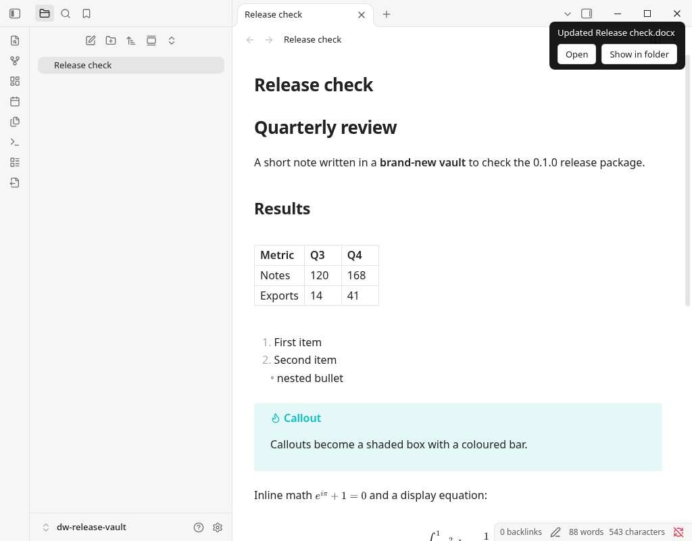
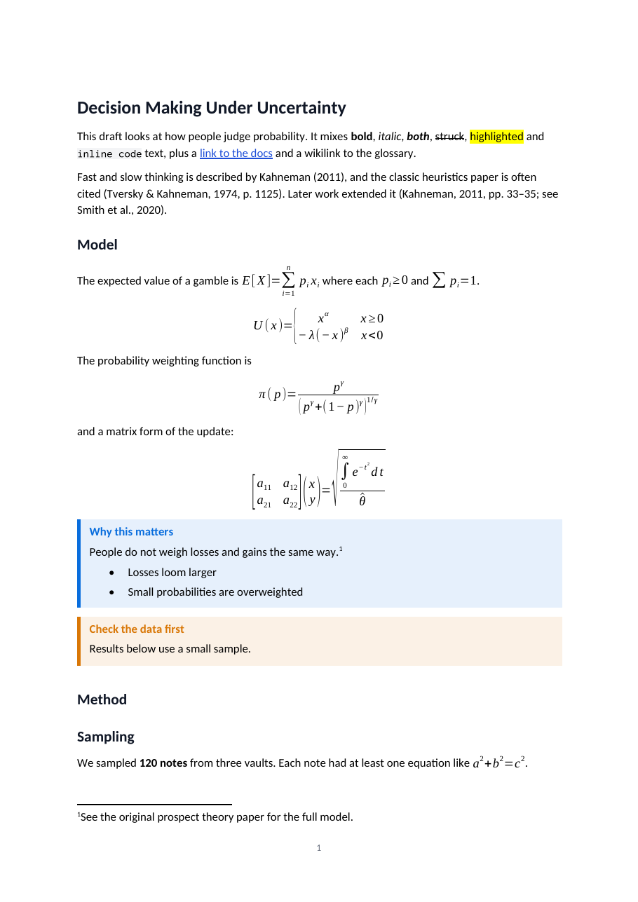
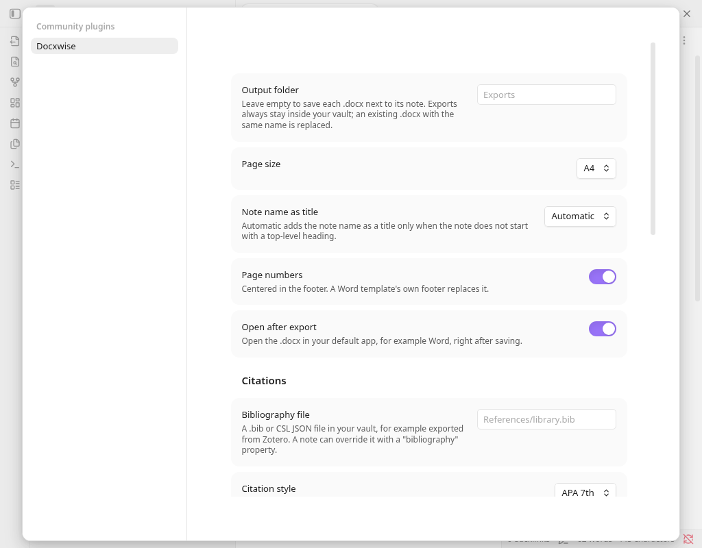

<!-- DRAFT (not published). Placeholders to resolve before release: checkout gate entry for product=docxwise-pro
     (local branch, disabled), formchime.com/docxwise/terms and /privacy pages (drafts, not deployed), GitHub repo URL. -->
# Docxwise

Export Obsidian notes to clean, editable Word (`.docx`) files. No Pandoc, no extra installs; works on desktop and mobile.





*Exported page rendered with LibreOffice for this screenshot. Equations are native Word equations; Word's own rendering can differ slightly.*

## Features

- Headings, bold, italic, strikethrough, ==highlights==, inline code, links
- Lists with real Word numbering (nested levels, restarts, custom start numbers), task lists
- Tables with column alignment and a repeating header row
- Images: local, embedded (`![[image.png|300]]`) and web images, sized to fit the page. SVG and WebP are converted to PNG so Word can show them.
- Code blocks with syntax colouring for common languages (Python, JavaScript/TypeScript, Java, C/C++, C#, Go, Rust, SQL, Bash, JSON, YAML, HTML/XML, CSS, Markdown and more)
- Callouts as shaded boxes in the callout's colour, including nested callouts
- Embedded notes, headings and blocks: `![[Note]]`, `![[Note#Section]]`, `![[Note#^block]]`
- Footnotes, including inline footnotes `^[like this]`, as real Word footnotes
- Math: `$...$` and `$$...$$` (including `aligned`, matrices and cases) become native Word equations you can edit in Word
- Citations: `[@key]`, `[@key, p. 12]`, `[see @a; @b]`, `@key` with a `.bib` or CSL JSON file (for example exported from Zotero). APA, Chicago (author-date and notes), MLA and IEEE are built in; any other `.csl` style file works too. Note styles such as Chicago notes produce footnotes automatically. The reference list goes at the end, or where you put `<!-- bibliography -->`.
- Mermaid diagrams are drawn with Obsidian's own Mermaid and inserted as images (light theme, even in dark mode).
- Dataview: regular ` ```dataview ` TABLE and LIST queries are exported as their results, as real Word tables and lists, when the Dataview plugin is enabled. DataviewJS blocks and inline queries can't be exported and stay as code; the export notice tells you.
- Comments `%%...%%` and block ids are left out.
- The free features work fully offline (see Network use disclosure).

**Docxwise Pro** (optional, one-time US$19 license)

- Your own Word template (`.docx` or `.dotx`): fonts, heading styles, colours, header and footer (including logos and page numbers), page size and margins, and document language
- Merge a folder, or a note and everything it links to, into one document

Pro checks your license online at most once a day and works offline for up to 7 days. Use it on up to 5 devices; full refund within 14 days. Not sold in Japan.

## Usage

Click the **Export current note to .docx** icon in the left ribbon, run the command of the same name from the command palette, or right-click a note → **Export to .docx**.

- The file is named after the note (`Meeting notes.md` → `Meeting notes.docx`) and saved next to it, unless you set an output folder in Settings → Docxwise. Exporting again replaces the earlier .docx.
- On desktop the .docx opens in your default app (turn this off in settings), and the notice has a **Show in folder** button. Obsidian hides .docx files in its file list unless Settings → Files and links → **Detect all file extensions** is on.
- On iPhone and iPad the file is in your vault folder: open the Files app → On My iPhone/iPad → Obsidian → your vault (or iCloud Drive → Obsidian). On Android it is in the vault folder you chose when creating the vault. From there you can open it in Word or share it.
- If something could not be exported exactly (a missing image, an unknown citation key, a DataviewJS block), the file is still saved and the notice lists what to check.



Per-note overrides in properties: `bibliography: refs/other.bib`, `csl: refs/nature.csl`, `reference-section-title: Sources`.

## Payment disclosure

- **The plugin is free to use. Pro is an optional paid license.** No account is needed for the free features.
- **One-time purchase, includes all future updates.** No subscription, and your key doesn't expire.
- Docxwise Pro costs **US$19 (plus VAT/sales tax where applicable, calculated and shown at checkout)** and is sold through **Polar** (https://polar.sh), which acts as the merchant of record and handles payment, tax and invoices. Polar emails you a license key. Obsidian does not sell or handle this payment.
- The **Buy Pro** button is shown only after you tick "I agree to the Terms of Service and Privacy Policy". It opens https://formchime.com/api/checkout?product=docxwise-pro, which redirects to a Polar checkout; checkout creates a customer record with Polar (email).
- A key can be active on **5 devices**. Paste the key in Settings → Docxwise → License key and press **Activate**. Need a 6th device? Deactivate an old one in the Polar customer portal (https://polar.sh/formchime/portal), then press **Activate** on the new device. Pressing **Remove** also releases that device's slot.
- **Refunds:** full refund within 14 days, just email support@formchime.com (or reply to your Polar receipt email). After a refund the license key is revoked and Pro features lock again; the free export keeps working.
- **Not available in Japan.** The Buy Pro button is hidden there. If you're charged from Japan, we refund in full and revoke the key; you can also email support@formchime.com. The free features work everywhere.

## Network use disclosure

- **Exporting never sends your notes anywhere.** Conversion runs entirely on your device.
- **Web images:** if a note links an image by `https://` URL, that image is downloaded from its server when you export the note (the same request your browser would make; that server sees your IP address). Local images make no requests.
- **Region check:** when you open Settings → Docxwise without an active Pro key, Docxwise sends one `GET https://formchime.com/api/region` request to check whether Pro can be sold in your region (nothing else is sent). This request sends your IP address to formchime.com, which reads only the country Cloudflare derives from it. formchime.com does not store your IP or country, and logging for its Worker is turned off; Cloudflare, which runs formchime.com, may keep short-term operational logs under its own policy. If the answer is "blocked", the Buy Pro button is hidden. If the request fails, times out (10 seconds) or returns an unexpected answer, the Buy Pro button is also hidden and the panel says "Couldn't check your region. Reopen settings later to try again."
- **Checkout:** when you press Buy Pro, formchime.com passes your IP to Polar to create the checkout (tax and fraud checks) and records your two-letter country code and the product name in that checkout's metadata; formchime.com itself does not keep them.
- **License:** with a key, when you press **Activate** or **Remove**, then at most **once a day** on startup, Docxwise contacts Polar:
  - `POST https://api.polar.sh/v1/customer-portal/license-keys/activate`: reserves one of the key's 5 device slots (sends the key, our public Polar organization ID and a device label such as "Obsidian – macOS – a1b2": app, platform and a random 4-character device code; no vault name, user name or host name).
  - `POST https://api.polar.sh/v1/customer-portal/license-keys/deactivate`: only when you press **Remove** (sends the key, organization ID and activation ID).
  - `POST https://api.polar.sh/v1/customer-portal/license-keys/validate`: confirms the key (sends the key, organization ID and activation ID).
- Nothing from your vault is sent: no note content, file names or citations.
- Offline: after a successful check, Pro stays unlocked for **7 days** without internet.
- No telemetry, analytics or ads. Privacy policies: formchime.com https://formchime.com/docxwise/privacy, Polar https://polar.sh/legal/privacy

## Data storage

- Settings and the cached license result are stored in `.obsidian/plugins/docxwise/data.json` in your vault.
- **License key:** on Obsidian 1.11.4+ it is stored in Obsidian's **Keychain** (Settings → Keychain, ID `docxwise-license-key`), not in vault files. On older Obsidian it is stored in plain text in `data.json`; the settings tab says so.
- The random device code is kept in Obsidian's local storage on this device, not in `data.json`.
- Exported `.docx` files are written inside your vault (next to the note, or in the output folder you set). No files outside your vault are read or written (besides Obsidian's own Keychain).

## Known limits

- Equations are made for Microsoft Word. LibreOffice opens them, but some layouts can differ slightly.
- The 7-day offline period uses your device clock.

## Support

Bugs and questions: GitHub issues (repository URL to be added). Billing and refunds: support@formchime.com.

## Credits

Docxwise bundles: docx (MIT, including its vendored fflate, nanoid and adapted stream-browserify code, all MIT), JSZip (MIT option of MIT/GPL-3.0) with pako (MIT and Zlib), markdown-it, markdown-it-footnote, linkify-it, mdurl, uc.micro and punycode.js (MIT), entities (BSD-2-Clause), Temml (MIT), highlight.js (BSD-3-Clause), citeproc-js by Frank Bennett (CPAL-1.0, bundled unmodified; its source is in `third_party/citeproc-2.4.63/`), and CSL styles and the en-US locale from the Citation Style Language project (CC BY-SA 3.0). Full license texts and the CPAL source-code notice are in `THIRD_PARTY_NOTICES.md`, which is also appended to `main.js`.

## License

MIT (see LICENSE). Bundled third-party components keep their own licenses (see `THIRD_PARTY_NOTICES.md`).
